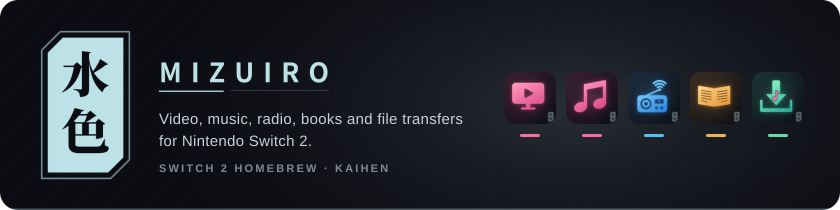
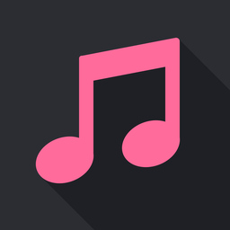
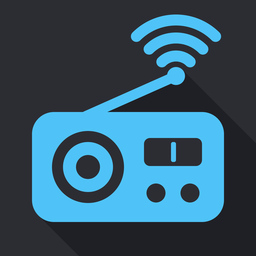
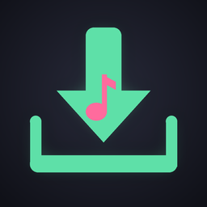
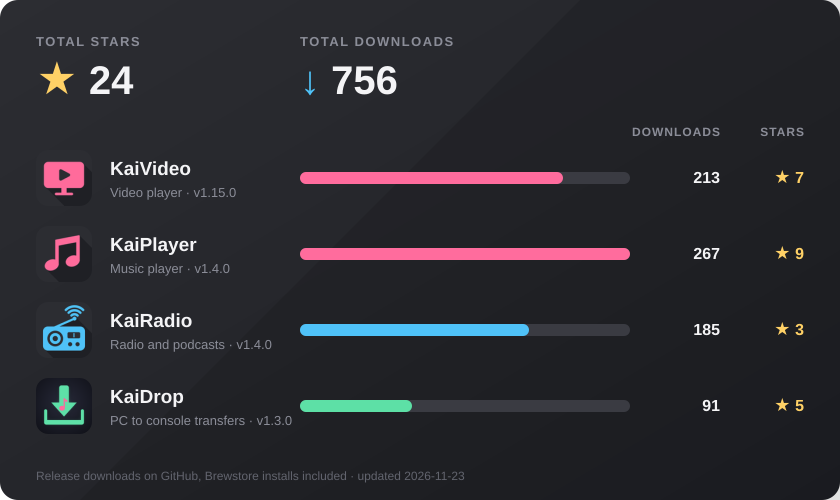

  

  Native apps for <b>Nintendo Switch 2</b> on <a href="https://github.com/ouncebrew">kaiHEN</a>, plus a PC tool to fill the console. 
  All of them install from <b>Brewstore</b>, are open source and run in 9 languages.

## Featured

<table>
  <tr>
    <td width="50%" valign="top">
      
      <h3>&nbsp;<a href="https://github.com/mizuiroame/kaivideo">KaiVideo</a></h3>
      &nbsp;
      
      
        
      Your films and series from the SD card, a network folder, or <b>Jellyfin, Emby and Plex</b>.
      Hardware H.264, VP9 and AV1, HEVC on the CPU, downloads to watch offline, Live TV, IPTV lists and styled subtitles.
        
      
    </td>
    <td width="50%" valign="top">
      
      <h3>&nbsp;<a href="https://github.com/mizuiroame/kaiplayer">KaiPlayer</a></h3>
      &nbsp;
      
      
        
      Your music library by artist and album, from the SD card, a network folder or <b>Navidrome</b>.
      FLAC, MP3, AAC, ALAC and more, an equalizer, playlists, and Now Playing as a turning record, CD or cassette.
        
      
    </td>
  </tr>
  <tr>
    <td width="50%" valign="top">
      
      <h3>&nbsp;<a href="https://github.com/mizuiroame/kairadio">KaiRadio</a></h3>
      &nbsp;
      
      
        
      Tens of thousands of radio stations on a 3D globe, by genre, country or name, with each country's time and weather.
      Plus <b>podcasts</b>: top charts by region, search and subscriptions.
        
      
    </td>
    <td width="50%" valign="top">
      
      <h3>&nbsp;<a href="https://github.com/mizuiroame/kaidrop">KaiDrop</a></h3>
      &nbsp;
      
      
        
      A Windows app to send music, videos and anything else to the console.
      Drag and drop both ways, transfers that resume after a cut, and names the console can actually list.
        
      
    </td>
  </tr>
</table>

## In numbers

  

Updated every day by a GitHub Action. Downloads are of the release files on GitHub, which Brewstore installs from too.

## How they're made

Written with AI, directed and tested by a person: I'm a mechatronics engineer, I decide the design, review the code and try every feature on the console before it's released. The apps have thousands of automated tests, security reviews and a `SECURITY.md` each.
